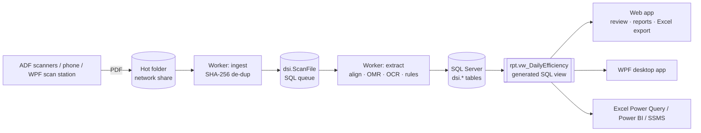

# DSI WorkForce – Press Worksheet Digitization (.NET 8 + SQL Server)

Turns the handwritten **PC-011-A "Work Sheet Press Section"** forms into data in **MS SQL Server**, shown exactly like
the **Daily Efficiency Report** Excel sheet, in a web app, a WPF desktop app, and directly in SQL views.
Built for ~5,000 sheets/day without the UI ever doing OCR work (so nothing freezes or crashes): about 1.2 s
per page per CPU core was measured, so 5,000 sheets take ~25–30 minutes on a 4-core server.



## What is in the box

| Project | What it does |
|---|---|
| `src/DSI.WorkForce.Core` | Pure business logic: form template model, value cleaning (`26/11/17` → 17-Nov-2026, `S2I4` → 5214), fuzzy matching to master data, validation rules, **report → SQL view generator**. |
| `src/DSI.WorkForce.Data` | SQL Server schema (DbUp migration scripts), Dapper repositories, SQL-table work queue. |
| `src/DSI.WorkForce.Extraction` | PDF → image (PDFium), page alignment (OpenCV), **tick-box / tally OMR**, pluggable handwriting recognizers (manual, Azure AI Document Intelligence, local Ollama VLM). |
| `src/DSI.WorkForce.Worker` | Windows Service: watches scanner hot folders, processes the queue in parallel, plus a `--calibrate` tool. |
| `src/DSI.WorkForce.Web` | ASP.NET Core 8 Blazor Server: dashboard, split-screen review, Excel-like reports + Excel export, report-column admin, upload, JSON API. Windows (AD) login. |
| `src/DSI.WorkForce.Desktop` | WPF (.NET 8) client: scan station (auto-upload a scanner folder), review screen, Excel-like report grid. Uses the web API. |
| `src/DSI.WorkForce.DbMigrator` | One command to create/upgrade the database, import templates and build the report views. |
| `templates/forms/PC-011-A.v1.json` | The paper form as data: 36 fields, their positions, types and rules. |
| `templates/reports/DailyEfficiency.json` | The Excel layout as data (columns, formulas, formats). |
| `database/` | Example queries (view data at DB level, Excel connection) and optional sample master data. |

## Results on the sample sheet (`DSI OCR.pdf`)

Measured by the integration test and the calibration tool on the real scan:

* Page alignment: OK (found the printed border, straightened to the template).
* **Hourly production grid:** 67 ticks were counted correctly row by row: 8, 9, 8, 8, 9, 8, 8, 9.
  × 6 tyres per tick = **402**, which equals the handwritten *Total Production* box. The two readings
  cross-check each other automatically.
* All **14 machine-checklist ticks** and both **signatures** were detected (OMR, 99%).
* Every empty box was recognized as empty. Only the **24 boxes that really contain handwriting** (date, press,
  EPF, shift, target, name, tyre, mould log, specs, 3 reasons, total) go to a recognizer or to a human.

## Quick start (developer PC, Windows)

```powershell
# 1. Database (creates DSIWorkForce on your SQL Server, imports PC-011-A and the Daily Efficiency report)
dotnet run --project src/DSI.WorkForce.DbMigrator -- --create-db --Database:ConnectionString="Server=localhost;Database=DSIWorkForce;Integrated Security=true;TrustServerCertificate=true"

# 2. Optional test master data
sqlcmd -S localhost -d DSIWorkForce -E -i database/SampleMasterData.sql

# 3. Check the template lines up with your scans (writes an overlay PNG + JSON, no DB needed)
dotnet run --project src/DSI.WorkForce.Worker -- --calibrate C:\scans\sample.pdf

# 4. Run the worker (watches C:\DSIWorkForce\hot\PC-011-A, see appsettings.Development.json)
dotnet run --project src/DSI.WorkForce.Worker

# 5. Run the web app  ->  https://localhost:xxxx  (Dashboard, Review, Reports, Upload, Report columns)
dotnet run --project src/DSI.WorkForce.Web

# 6. Desktop app: open DSIWorkForce.sln in Visual Studio 2022, start DSI.WorkForce.Desktop
```

Tests: `dotnet test tests/DSI.WorkForce.Tests` (45 tests: normalization, matching, OMR, rules, report SQL,
and **T-SQL syntax of every script and query**, checked with Microsoft's ScriptDom parser).
Set `DSI_SAMPLE_PDF=C:\path\scan.pdf` to also run the real-scan integration test.
Scans are not committed because they contain employee data.

## Documentation

1. [Architecture & data model](docs/01-architecture.md): why it is built this way and how it stays stable at 5,000 sheets/day.
2. [Step-by-step rollout guide](docs/02-step-by-step-guide.md): from empty server to production.
3. [Customizing](docs/03-customizing.md): **add an Excel column**, capture a new box from the form, add a new form type.
4. [Form redesign recommendations](docs/04-form-redesign.md): small print changes that remove most manual typing.
5. [Deployment & operations](docs/05-deployment.md): IIS, Windows Service, accounts, sizing, backups, monitoring.

## Things to confirm with production

* **Units per tick = 6** (template default; set per press in `dsi.Machine.UnitsPerTick`). On the sample sheet
  67 ticks × 6 = 402 = Total Production, so a tick looks like one press cycle of 6 cavities.
* **Efficiency formula.** The Excel sample computes `Units ÷ Standard rate per hour` (=V/W). This system defaults to
  `Units ÷ (Standard rate per hour × hours with production)`. It is one editable expression in *Report columns*.
* Checklist meaning: a tick is stored as `1`. The form cannot tell "checked OK" from "checked, problem found"
  (see the form-redesign doc).
