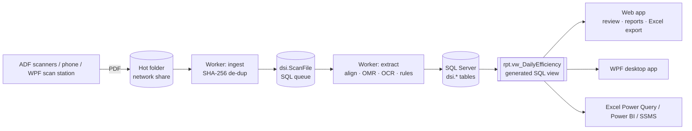

# DSI WorkForce – Press Worksheet Digitization (.NET 8 + SQL Server)

Turns the handwritten **PC-011-A "Work Sheet Press Section"** forms into data in **MS SQL Server**, shown exactly like
the **Daily Efficiency Report** Excel sheet, in a web app, a WPF desktop app, and directly in SQL views.
Built for ~5,000 sheets/day without the UI ever doing OCR work (so nothing freezes or crashes): about 1.2 s
per page per CPU core was measured, so 5,000 sheets take ~25–30 minutes on a 4-core server.



## What is in the box

| Project | What it does |
|---|---|
| `src/DSI.WorkForce.Core` | Pure business logic: form template model, value cleaning (`26/11/17` → 17-Nov-2026, `S2I4` → 5214), fuzzy matching to master data, validation rules, **report → SQL view generator**. |
| `src/DSI.WorkForce.Data` | SQL Server schema (DbUp migration scripts), Dapper repositories, SQL-table work queue. |
| `src/DSI.WorkForce.Extraction` | PDF → image (PDFium), page alignment (OpenCV), **tick-box OMR**, per-cell blank detection, pluggable handwriting recognizers (manual, Azure AI Document Intelligence, local Ollama VLM). |
| `src/DSI.WorkForce.Worker` | Windows Service: watches scanner hot folders, processes the queue in parallel, plus a `--calibrate` tool. |
| `src/DSI.WorkForce.Web` | ASP.NET Core 8 Blazor Server: dashboard, split-screen review, Excel-like reports + Excel export, report-column admin, upload, JSON API. Windows (AD) login. |
| `src/DSI.WorkForce.Desktop` | WPF (.NET 8) client: scan station (auto-upload a scanner folder), review screen, Excel-like report grid. Uses the web API. |
| `src/DSI.WorkForce.DbMigrator` | One command to create/upgrade the database, import templates and build the report views. |
| `templates/forms/PC-011-A.v1.json` | The paper form as data: 36 fields, their positions, types and rules. |
| `templates/reports/DailyEfficiency.json` | The Excel layout as data (columns, formulas, formats). |
| `database/` | Example queries (view data at DB level, Excel connection) and optional sample master data. |

## Results on the sample sheet (`DSI OCR.pdf`)

Measured by the integration test and the calibration tool on the real scan:

* Page alignment: OK (found the printed border, straightened to the template).
* **Hourly production grid (8 hours × 12 cells, a handwritten number in each cell):** every cell is located
  individually and blank cells are skipped. On the sample, exactly the right cells were found filled in each hour:
  8, 9, 8, 8, 9, 8, 8, 9 (67 cells). Hourly units = sum of the row; the sum of all cells is checked against the
  handwritten *Total Production* box (e.g. 67 × 6 = **402**). When the two agree, both are trusted automatically.
* All **14 machine-checklist ticks** and both **signatures** were detected (OMR, 99%).
* Every empty box was recognized as empty. Only boxes that really contain handwriting go to a recognizer or to
  a human: on the sample, 67 hourly cells + 24 other boxes (date, press, EPF, shift, target, name, tyre, mould
  log, specs, 3 reasons, total).
* The orange column (නිසැදු වාර ගණන) is captured as **Rejection** per hour and shown as a report column.
* **Handwriting OCR runs locally by default** (PaddleOCR PP-OCRv5 on the CPU, free, offline). On the sample it read
  13 of 13 key numeric values correctly: EPF 5916, press P-24, shift 2-10, target 390, total 402, mould log 24…19,
  steam pressure 15-0150. The date (slashes) and messy free text are the weak spots. Those go to review or to an
  optional second engine (Azure / Ollama) for unsure boxes only.

## Quick start (developer PC, Windows)

Using Visual Studio 2022? Follow **[docs/06-visual-studio-2022.md](docs/06-visual-studio-2022.md)**. Command-line version:

```powershell
# Database: nothing to do in Development. Web and Worker create (localdb)\MSSQLLocalDB / DSIWorkForce automatically
# (Windows authentication), apply migrations, import the template + reports and load sample master data.
# (Manual alternative: dotnet run --project src/DSI.WorkForce.DbMigrator -- --seed-sample-data)

# 1. Local folders used by the development settings
New-Item -ItemType Directory -Force -Path C:\DSIWorkForce\hot\PC-011-A, C:\DSIWorkForce\staging, C:\DSIWorkForce\duplicates, C:\DSIWorkForce\images, C:\DSIWorkForce\samples

# 2. Check the template lines up with your scans (writes an overlay PNG + JSON, no DB needed)
dotnet run --project src/DSI.WorkForce.Worker -- --calibrate C:\DSIWorkForce\samples\sample.pdf

# 3. Run the worker (watches C:\DSIWorkForce\hot\PC-011-A) and, in a second terminal, the web app
dotnet run --project src/DSI.WorkForce.Worker
dotnet run --project src/DSI.WorkForce.Web --launch-profile https     # -> https://localhost:7082

# 4. Desktop app: open DSIWorkForce.sln in Visual Studio 2022, start DSI.WorkForce.Desktop
```

Tests: `dotnet test tests/DSI.WorkForce.Tests` (53 tests: normalization, matching, OMR, rules, report SQL,
and **T-SQL syntax of every script and query**, checked with Microsoft's ScriptDom parser).
Set `DSI_SAMPLE_PDF=C:\path\scan.pdf` to also run the real-scan integration test.
Scans are not committed because they contain employee data.

## Documentation

1. [Architecture & data model](docs/01-architecture.md): why it is built this way and how it stays stable at 5,000 sheets/day.
2. [Step-by-step rollout guide](docs/02-step-by-step-guide.md): from empty server to production.
3. [Customizing](docs/03-customizing.md): **add an Excel column**, capture a new box from the form, add a new form type.
4. [Form redesign recommendations](docs/04-form-redesign.md): small print changes that remove most manual typing.
5. [Deployment & operations](docs/05-deployment.md): IIS, Windows Service, accounts, sizing, backups, monitoring.
6. [Run it in Visual Studio 2022](docs/06-visual-studio-2022.md): install, create the DB, run Worker + Web + WPF, try a scan.

## Things to confirm with production

* **Report shape.** *Daily Efficiency* has **one row per hour** (as in the Excel): columns `1..12` are the 12 cells
  of that hour, Start/End time = that hour, Efficiency = units ÷ standard rate per hour (=V/W).
  *Shift Summary* has one row per sheet (hours 1–8, totals, shift efficiency, target %).
* **Standard rate per hour** comes from `dsi.Item.StandardRatePerHour` (the Excel had `=52/2`).
* Checklist meaning: a tick is stored as `1`. The form cannot tell "checked OK" from "checked, problem found"
  (see the form-redesign doc).
